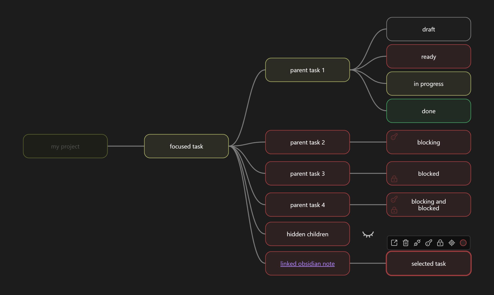

# Taskmap

Plan projects as visual task trees in Obsidian.
Taskmap lays out the tree automatically, so you never have to drag boxes around to keep it readable.



**Draft** is gray, **Ready** is red, **In progress** is yellow, and **Done** is green.

## Why Taskmap?

Large Kanban boards get hard to read. Taskmap shows your project as a color-coded tree, so you can see at a glance:

- Which tasks are done, in progress, or ready to start
- Which tasks are blocked, and by what
- How the work breaks down from goals into subtasks

## How to install

Install Taskmap from its [Obsidian plugin page](https://community.obsidian.md/plugins/taskmap), or open **Settings → Community plugins → Browse** in Obsidian and search for **Taskmap**.

Obsidian Sync skips `.taskmap` files by default. To sync them, turn on **Sync all other types** in **Settings → Sync** on each device.

## How to use

- Click the Taskmap ribbon icon or run **Taskmap: Create new map** from the command palette to create a map in the vault root. To create one in a specific folder, right-click the folder in the file explorer and click **New taskmap**. The map is named like `Example_26-10-10_03.44.12.taskmap`, with `_1`, `_2`, and so on added if that name is taken, and opens in a new tab.
- Hover a task and click **+** to add a child. The new task is named `task` and starts as **Ready**.
- Select a task to open its toolbar. Hover a toolbar button to see its name.
- Select a task, then click its name to rename it.
- Drag a task to reorder it among its siblings.
- Hover a task and click the eye icon to hide its children.

## Feature reference

### Root task

Every map starts with a task named `root`, with status **Draft**. Like any parent set to **Draft**, it stays a draft after you add children, until you click its calculated status in its **Status** menu. Rename it to your project's name. The root can't be reparented, removed, or used as a blocker.

### Layouts

To choose a layout for a map, click **Settings** next to the undo and redo controls, then choose a **Layout**:

- **Tree** (default): the root's children sit in one column to the right of the root.
- **Double row**: the root's children alternate between a row above the root and a row below it. Use it when the root has many children and one column gets too tall.

### Rename a task

Select a task, then click its name. Click somewhere else to apply the name. This works the same way for every task, including the root.

Long names wrap, and the box grows with the text. The tree lays itself out again to fit.

### Reorder tasks

Drag a task up or down to change its place among the other tasks under the same parent. The task stays under that parent, and its children move with it. The root can't be dragged.

As you drag, the other tasks shift to make room. Release the mouse button to leave the task in its new place.

### Hide tasks

Hover a task and click the eye icon to collapse its descendants. Hidden tasks stay in the file; click the eye icon again to show them.

### Pan and zoom

Drag an empty area of the map with the left or middle mouse button to pan. Swipe with two fingers on a trackpad to pan. Scroll the mouse wheel, or pinch on a trackpad, to zoom. Zoom ranges from 10% to 300%.

### Toolbar

Select a task to open its toolbar. Hover a button to see its name. The root's toolbar has only **Add link**, **Focus**, and **Status**.

#### Linked notes

Click **Add link** to create a note named after the task and link the two. If a note with that name already exists, it's linked instead.

New notes go to the project's note folder, then the plugin's default note folder. If neither is set, they follow Obsidian's **Default location for new notes** setting.

To link an existing note, type `[[` in the task name and choose a note from the suggestions. Typing `[[Meeting notes]]` renames the task to that note and links it.

Click the link while the task is not selected to open or focus the note. Hover the link to show Obsidian's link preview. If the task is already selected, clicking its name starts editing, and the link is not followed.

Once a task is linked to a note:

- Renaming the note renames the task.
- Moving the note or renaming its folder keeps the link.
- Deleting the note removes the link; the task keeps its name.
- Renaming the task breaks the link; the note is left unchanged.

A task name can also be any Markdown link, such as `[Design doc](https://example.com/design)`.

#### Remove tasks

Select a task, click **Remove** in its toolbar, then choose:

- **Remove single task** removes only the selected task. Its children move up and take its place under its parent.
- **Remove task branch** removes the selected task and all its descendants.

#### Move a task to another parent

Select a task, click **Reparent**, then click the new parent on the map. The task moves with all its children and becomes the last child of the new parent. The new parent can't be the task itself, its current parent, or one of its descendants. Click an empty area to cancel.

#### Blockers

Select a task, then:

- Click **Add blocker task**, then click the task that blocks the selected one.
- Click **Block another task**, then click the task that the selected one blocks.

Click an empty area to cancel.

While **Add blocker task** or **Block another task** is active, click a task that is already connected to remove that connection. A task can't be connected to itself, to an ancestor, to a descendant, or to a task that is **Done**.

A blocked task cannot be marked done until all its blockers are done. A key icon marks a task that blocks others, and a lock icon marks a task that is blocked.

Blocker connections are drawn as orange lines. They appear while **Add blocker task** or **Block another task** is active, and when you hover a task's icons:

- Hover the key icon to highlight the tasks it blocks.
- Hover the lock icon to highlight the tasks that block it.

#### Focus

Click **Focus** to work on one task and its subtree without distractions. Everything else is hidden for a while, except the chain of parents that leads from the task up to the root. Click **Focus** again to bring back the full map.

#### Statuses

Each task has one of four statuses: **Draft**, **Ready**, **In progress**, or **Done**. The colors are listed under the screenshot.

To change a status, select the task, then click **Status** in its toolbar and choose a status.

Leaf tasks (tasks without children) can be set to any status. A parent task's status is calculated from its children:

- **Done** if all children are done
- **In progress** if at least one child is done or in progress
- **Ready** otherwise, including when all children are drafts

A parent's **Status** menu offers only **Draft** and its calculated status. A task you set to **Draft** stays a draft whatever its children do, until you click its calculated status.

### Undo and redo

Use the undo and redo controls in the bottom-left corner of the map.

Undo history is cleared when you close the file.

### Keyboard shortcuts

Shortcuts work while the map has focus.

| Action | Windows and Linux | macOS |
| --- | --- | --- |
| Zoom in | **Ctrl+Up arrow** | **Cmd+Up arrow** |
| Zoom out | **Ctrl+Down arrow** | **Cmd+Down arrow** |
| Undo | **Ctrl+Z** | **Cmd+Z** |
| Redo | **Ctrl+R** or **Ctrl+Shift+Z** | **Cmd+R** or **Cmd+Shift+Z** |
| Remove the selected task, like **Remove single task** | **Delete** | **Fn+Delete** |
| Clear the selection, or cancel **Reparent**, **Add blocker task**, or **Block another task** | **Escape** | **Escape** |
| Apply a task name while renaming | **Escape** | **Escape** |
| Add a line break while renaming | **Enter** | **Enter** |
| Choose the highlighted note suggestion | **Tab** | **Tab** |

### Settings

Plugin settings are in **Settings → Taskmap**:

- **Theme**: **Obsidian** (default) uses the active Obsidian theme's red, yellow, and green, and its faint text color for drafts, so community themes can change the exact shades. **Light** and **Dark** force Taskmap's own light and dark shades.
- Zoom sensitivity, set separately for mouse, touchpad, and keyboard
- **Reverse two-finger pan** (on by default): moves the map opposite to your fingers when you swipe on a touchpad
- Default folder for linked notes

Project settings override the note folder for a single map and set its **Layout** (see [Layouts](#layouts)). To open them, click **Settings** next to the undo and redo controls.

## Files

A `.taskmap` file is JSON stored in the vault. Rename or move it in the file explorer; an open map follows the file.

Obsidian Sync skips `.taskmap` files unless **Sync all other types** is turned on in **Settings → Sync**.

## Current limitations

- Works only in the Obsidian desktop app.
- Has no sharing or collaboration features.
- Tasks have no due dates or assignees.
- Tasks are stored only in the `.taskmap` file and don't sync with Markdown checkboxes or task plugins.
- The interface is available only in English.

## Bugs and missing features

- **Obsidian sync support**
- **Documentation is incomplete.** Some behavior isn't described here yet. If something is unclear, [open an issue](https://github.com/poanse/obsidian-taskmap/issues).
- **Zoom buttons.** You can zoom only with the mouse, trackpad, or keyboard. On-screen buttons to zoom in, zoom out, and reset the zoom are planned.
- **Shortcut reference.** The map doesn't list its keyboard shortcuts. A help panel that describes them, like the one in Canvas, is planned.
- **Multi-select.** You can select only one task at a time. Selecting several tasks by dragging a box around them with the left mouse button is planned.
- **Plugin mobile support.** Taskmap works only in the desktop app. Support for Obsidian on phones and tablets is planned.
- **Standalone website.** Taskmap projects can only be viewed and edited in Obsidian. A website where you can work on them without Obsidian and share them with others via a link is planned.

## Contributions

Blocker UX and most of the UI were designed by [Mulcere](https://www.behance.net/mulcere).

## Development

Clone the repository into your vault's `.obsidian/plugins/` folder, then install dependencies and start the watcher:

```bash
npm install
npm run dev
```

Enable Taskmap in **Settings → Community plugins**, and reload Obsidian after each rebuild to load the changes.

Other commands:

```bash
npm run build
npm test
npm run lint
npm run perf:tasks
```

`npm run dev` rebuilds the plugin as you edit. `npm run build` writes a production `main.js`. `npm test` runs the tests. `npm run lint` runs the linter. `npm run perf:tasks` benchmarks task lookup and layout.

## Links

- [Obsidian plugin page](https://community.obsidian.md/plugins/taskmap)
- [Report an issue](https://github.com/poanse/obsidian-taskmap/issues)
- [Source code](https://github.com/poanse/obsidian-taskmap)
- [License](https://github.com/poanse/obsidian-taskmap/blob/master/LICENSE)
- [Buy me a coffee](https://www.buymeacoffee.com/poanse)
